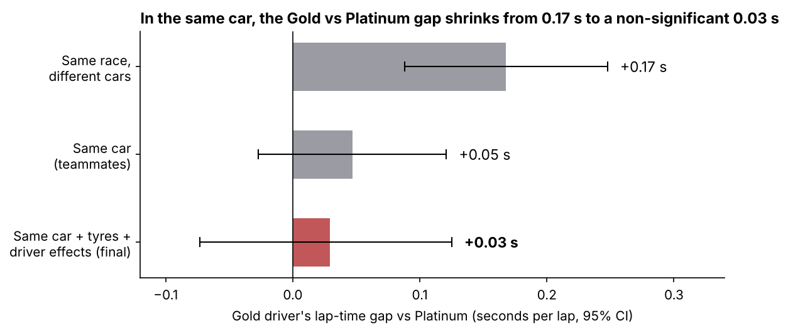
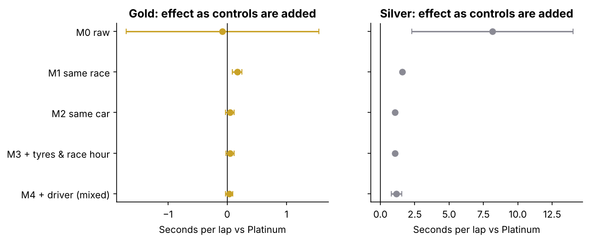

# Same Car, Different Driver

**Do official FIA driver ratings show up in lap times when two drivers share the same car?**
A statistical analysis of 64,000 IMSA endurance-racing laps (2023–2026).


[](https://github.com/behalsrishti08/same-car-different-driver/actions/workflows/python-app.yml)

**Srishti Behal**

## In 30 seconds

- **Question.** Racing drivers are officially rated Platinum, Gold, Silver or Bronze. Do lower-rated drivers really lap slower, or do they just drive slower cars?
- **Approach.** In endurance racing, 2–4 drivers share one car in the same race. Comparing teammates holds the car, team and conditions constant, so the remaining gap is the driver. A mixed-effects model estimates it, with bootstrap error bars, leave-one-race-out validation and a placebo test.
- **Finding.** Gold drivers look 0.17 s/lap slower than Platinum when compared across different cars. Against a teammate in the **same car**, the gap is **0.03 s/lap and not statistically significant** (95% CI −0.07 to +0.13). Most of the apparent rating gap is the car, not the driver.



## What this project shows I can do

| Skill | Where |
|---|---|
| Clean and audit a messy real dataset (373k laps), with every removed lap accounted for | `src/scd/data.py`, cleaning funnel figure |
| Catch data-quality problems: 5 drivers were stored under two spellings, so 89 names were really 84 people | `data/driver_aliases.csv` |
| Design a fair comparison that removes a confounder (the car) by construction | within-car demeaning in `src/scd/model.py` |
| Fit and explain a linear mixed-effects model, adding controls in blocks to show what each explains | `src/scd/model.py`, ablation figure |
| Validate honestly: race-level bootstrap, leave-one-race-out, permutation placebo test | `src/scd/evaluate.py` |
| Prove the method works by testing it on simulated data with a known answer | `tests/test_pipeline.py` |
| Build a reproducible pipeline: one command from raw files to every table, figure and number | `run_analysis.py` |
| Report limitations plainly (small Silver sample, ratings changing over time, observational data) | Limitations below |

## Main results

All numbers come from `outputs/results.md`. Re-running the analysis regenerates them.

| | |
|---|---|
| Clean laps | 64,001 from 33 races, 345 car-races, 84 drivers |
| Teammate gap (all drivers) | median **0.36 s/lap** (middle half 0.16–0.64 s) |
| Pace spread, within a race | 53% between cars · 47% between teammates (F1 studies: ~88% car) |
| Tyre wear | ~0.006 s per extra lap on a set |
| **Gold vs Platinum, same car** | **+0.03 s/lap** (95% bootstrap CI −0.07 to +0.13; placebo p = 0.39) |
| Silver vs Platinum, same car | +1.17 s/lap, but **one driver, one race** (case study) |

How the estimate changes as each control is added (M0 raw → M4 final model):



## How it works

```
373k laps (Kaggle, all classes)
  → 82,348 top-class laps with driver names
  → 64,001 clean laps (green flag, no pit in/out laps, within 107% of race median)
  → teammate gaps and car-vs-driver split          (Experiments 1–2)
  → models with controls added in blocks           (Experiment 3)
  → bootstrap, leave-one-race-out, placebo         (evaluation)
```

**Model.** Every lap time is measured relative to its own car's average in that race ("demeaning"). This removes everything teammates share. A linear mixed-effects model (statsmodels `MixedLM`) then estimates:

```
lap time vs car average = rating effect + tyre age + race hour + driver's own bit + noise
                          (fixed)         (fixed)    (fixed)     (random)
```

Controls are added one block at a time (M0 raw → M1 same race → M2 same car → M3 + tyres → M4 + driver). This shows how much of the raw gap each factor explains.

**Checks.**

| Check | Method | What it shows |
|---|---|---|
| How big, how sure? | Bootstrap: resample whole races 1,000× | 95% error bars |
| Is it fair? | Baseline vs model (ablation) | The gap shrinks as the car is controlled |
| Does it hold? | Leave-one-race-out (33 folds) | The effect is stable across races |
| Does it fit? | MAE / RMSE / R² on held-out races | vs predicting "every teammate equal" |
| Is it real? | Placebo: shuffle ratings 500× | Fake effects center on zero |

Testing is always done **by race, not by lap**, because laps from one race share weather, track and traffic.

## Run it yourself (Mac)

```bash
# 1. Get the code
git clone https://github.com/behalsrishti08/same-car-different-driver.git
cd same-car-different-driver

# 2. Install Python packages (once)
python3 -m venv .venv
source .venv/bin/activate
pip install -r requirements.txt

# 3. Put the Kaggle IMSA CSVs in data/raw/  (see data/raw/README.md)

# 4. Run
python run_analysis.py --quick   # ~1 minute, for checking
python run_analysis.py           # full run, ~12 minutes
python -m pytest -q              # tests on made-up data with a known answer
```

## Project layout

```
run_analysis.py          one command: raw laps → tables, figures, results.md
src/scd/
  data.py                load, fix driver names, add ratings, clean laps
  gaps.py                teammate gaps, car-vs-driver split, raw comparison
  model.py               the five models (ablation) and the mixed model
  evaluate.py            bootstrap, leave-one-race-out, placebo
  plots.py               figures
data/
  driver_aliases.csv     same person spelled two ways (e.g. Alex / Alexander Palou)
  driver_ratings.csv     FIA rating for each driver, with source
  raw/                   Kaggle CSVs (not committed)
tests/test_pipeline.py   checks the method recovers a known effect on simulated laps
outputs/                 results.md, tables/, figures/
```

## Limitations

- **Ratings.** The data has no rating column. Ratings were added from current FIA categorisation lists, and 5 drivers are still unrated (see `data/driver_ratings.csv`). Categories can change between seasons.
- **Silver and Bronze.** Driver names exist only for the top class, which is almost all Platinum and Gold. Silver is one driver and Bronze has none, so those tiers can't be estimated here.
- **Observational data.** Teams choose who drives when (e.g. putting the slower driver in easier conditions), which can bias the effect toward zero. Traffic is not observed.
- **Weather** is missing for 46% of laps, so it isn't used as a control.

## Data and references

- Data: Motorsport Strategy Lab, *Derived data*, Kaggle (IMSA files). FIA Driver Categorisation.
- Bell, Smith, Sabel & Jones (2016). Formula for success: multilevel modelling of F1 driver and constructor performance. *J. Quant. Analysis in Sports.*
- van Kesteren & Bergkamp (2023). Bayesian analysis of F1 race results. *J. Quant. Analysis in Sports.*
- Heilmeier, Graf & Lienkamp (2018). A race simulation for strategy decisions in circuit motorsports. *IEEE ITSC.*
- Hernán & Robins (2020). *Causal Inference: What If.*
- Motorsport Strategy Lab, Kaggle (IMSA lap data) · FIA Driver Categorisation.
